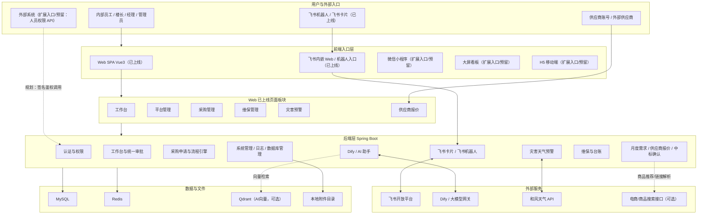
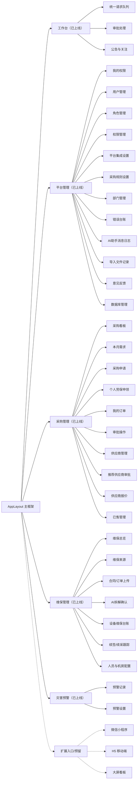
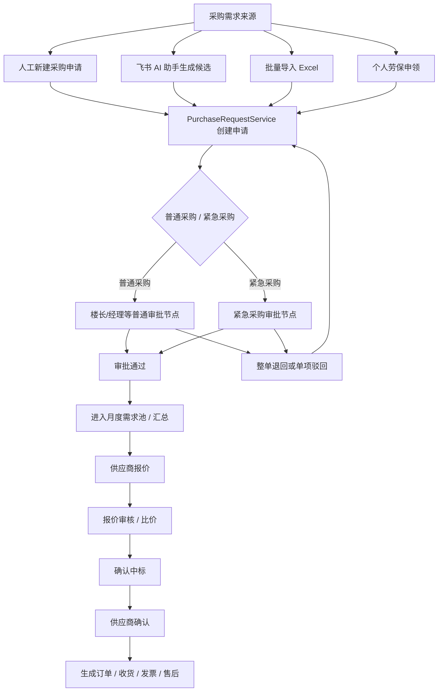
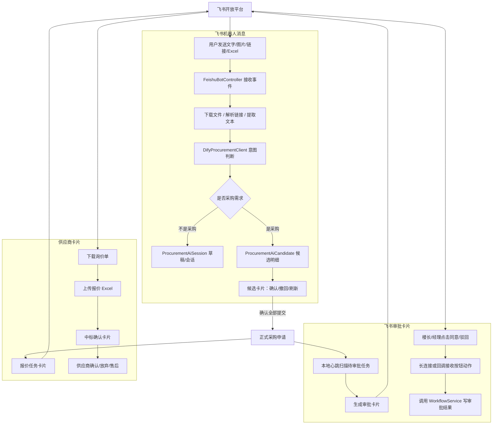
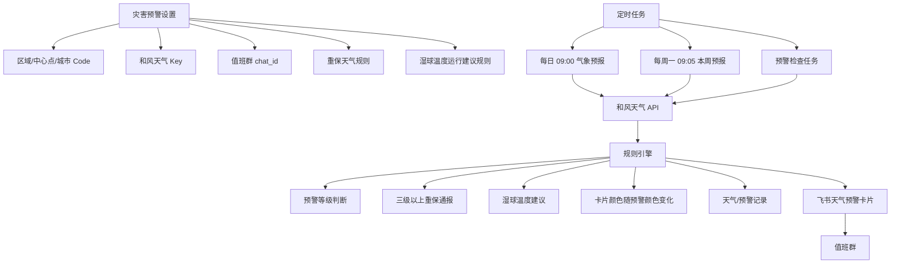
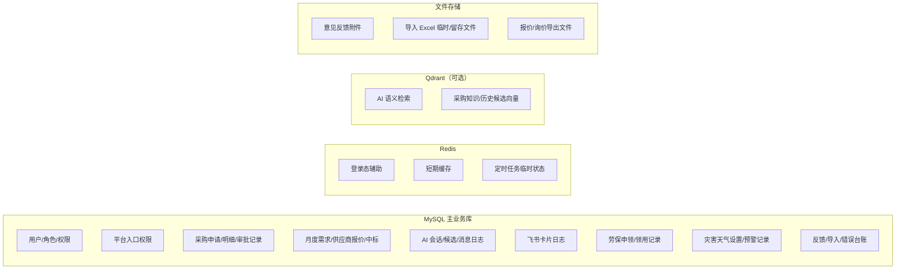
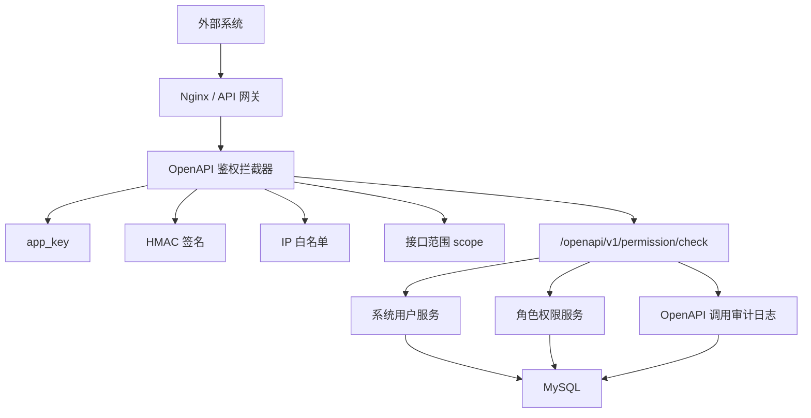

# 酒仙桥区域运维平台架构图（按板块）

> 说明：本文按系统实际板块拆分架构，便于给管理人员、开发人员或外部系统对接方说明系统边界。图中“已上线”表示当前代码已有路由或后端服务；“扩展入口/预留”表示建议扩展点，不代表当前已经全部上线；“可选依赖”表示配置后可接入，不是主流程必需。

## 1. 系统总览

这个图说明整个平台从用户入口、前端、后端、外部集成到数据存储的整体关系。

## 2. 前端功能板块

这个图说明用户在页面上看到的主要菜单和页面分组。

## 3. 后端模块板块

这个图说明 Spring Boot 后端按业务域拆分后的模块边界。

```mermaid
flowchart TB
    API["HTTP API / Controller"]

    API --> AUTH["auth 认证模块"]
    AUTH --> AUTH1["账号密码登录"]
    AUTH --> AUTH2["飞书 OAuth 登录"]
    AUTH --> AUTH3["JWT / 当前用户信息"]

    API --> SYS["system 系统用户模块"]
    SYS --> SYS1["用户管理"]
    SYS --> SYS2["角色管理"]
    SYS --> SYS3["权限分配"]
    SYS --> SYS4["飞书组织同步"]

    API --> PLATFORM["platform 平台管理模块"]
    PLATFORM --> PF1["平台入口权限"]
    PLATFORM --> PF2["错误台账"]
    PLATFORM --> PF3["AI助手消息日志"]
    PLATFORM --> PF4["导入文件记录"]
    PLATFORM --> PF5["意见反馈"]
    PLATFORM --> PF6["数据库管理"]
    PLATFORM --> PF7["灾害天气预警"]

    API --> WORKBENCH["workbench 工作台模块"]
    WORKBENCH --> WB1["统一请求队列"]
    WORKBENCH --> WB2["审批详情"]
    WORKBENCH --> WB3["审批动作入口"]

    API --> PROCUREMENT["procurement 采购模块"]
    PROCUREMENT --> PR1["采购申请"]
    PROCUREMENT --> PR2["审批流程"]
    PROCUREMENT --> PR3["月度需求"]
    PROCUREMENT --> PR4["供应商报价"]
    PROCUREMENT --> PR5["中标确认"]
    PROCUREMENT --> PR6["订单/收货/售后"]
    PROCUREMENT --> PR7["个人劳保"]
    PROCUREMENT --> PR8["采购看板 BI"]

    API --> SUPPLIER["supplier 供应商模块"]
    SUPPLIER --> SP1["供应商档案"]
    SUPPLIER --> SP2["临时供应商推荐"]
    SUPPLIER --> SP3["供应商账号绑定"]

    API --> INTEGRATION["integration 集成模块"]
    INTEGRATION --> I1["飞书审批卡片"]
    INTEGRATION --> I2["飞书长连接回调"]
    INTEGRATION --> I3["飞书消息推送"]

    API --> MAINT["maintenance 维保模块"]
    MAINT --> MA1["维保台账"]
    MAINT --> MA2["合同/订单解析"]
    MAINT --> MA3["续签跟踪"]
```

## 4. 采购核心流程板块

这个图说明普通采购、紧急采购、AI 创建采购申请、月度汇总、供应商报价和中标确认如何走同一条主流程。

### 说明

- AI 助手只是输入采集层，不能绕过 `PurchaseRequestService` 和原审批流程。
- 普通采购和紧急采购仍走原有流程节点，不能新建一条旁路。
- 单项驳回本质是“驳回部分明细，其他明细继续流转”，不能当成独立卡片状态处理。

## 5. 飞书与 AI 板块

这个图说明飞书机器人、Dify、AI 候选、审批卡片、供应商卡片之间的关系。

### 说明

- Dify 负责意图判断、候选生成、AI审核意见建议。
- 后端必须保存 Dify 请求、响应、解析结果，方便在“AI助手消息日志”里排障。
- 飞书卡片只是交互入口，最终审批动作必须回到系统工作流服务。

## 6. 灾害天气预警板块

这个图说明灾害预警从配置、定时任务、天气接口、规则判断到飞书值班群推送的路径。

### 说明

- 天气地点不应写死在代码里，应从后台设置读取。
- 重保规则、预警颜色、湿球温度建议都应可在后台维护。
- 测试按钮用于手动触发拉取和推送，方便上线前验证。

## 7. 数据存储板块

这个图说明当前系统主要数据落点。

## 8. 权限与外部系统开放 API（规划板块）

这个图说明后续如果给外部系统调用人员权限，建议放在独立开放 API 层，避免直接暴露后台管理接口。

### 说明

- 外部系统只建议查“某人是否有某权限”，不要直接开放改角色、删用户、改权限。
- 每个外部系统一个 `app_key/app_secret`，并记录调用日志。
- 返回数据要最小化，不返回飞书 open_id、手机号、密码、token 等敏感字段。

## 9. 板块职责速查

| 板块 | 主要页面/入口 | 主要后端模块 | 当前状态 | 作用 |
|---|---|---|---|---|
| 工作台 | `/workbench` | `workbench` | 已上线 | 统一查看待办、已办、我发起、审批处理。 |
| 平台管理 | `/platform/*` | `platform`, `system` | 已上线 | 管用户、角色、入口权限、设置、日志、反馈、数据库。 |
| 采购管理 | `/procurement/*` | `procurement`, `supplier` | 已上线 | 采购申请、审批、月度汇总、报价、中标、订单、劳保。 |
| 供应商 | `/procurement/quotes`, `/procurement/sold-orders` | `supplier`, `procurement/order` | 已上线 | 报价、确认中标、发货、售后、发票相关协作。 |
| 飞书集成 | 飞书机器人/卡片 | `integration/feishu`, `procurement/assistant` | 已上线 | 飞书登录、机器人消息、审批卡片、供应商卡片。 |
| AI 助手 | 飞书机器人、AI日志 | `procurement/assistant`, `platform/aimessagelog` | 已上线 | 意图识别、候选生成、AI审核意见、日志追踪。 |
| 灾害预警 | `/disaster-weather/*` | `platform/disaster` | 已上线 | 天气预报、重保预警、湿球温度建议、飞书值班群推送。 |
| 维保管理 | `/maintenance/*` | `maintenance` | 已上线 | 维保来源、合同上传、AI拆解、设备台账、续签。 |
| 数据与审计 | 数据库管理、日志页面 | `platform/database`, `platform/errorlog` | 已上线 | 管理数据、查看错误、追踪导入和 AI 消息。 |
| 飞书工作台入口 | 飞书内嵌 Web / 机器人 / 卡片 | `auth`, `procurement/assistant`, `workflow` | 已上线 | 通过飞书登录、机器人消息和卡片按钮进入系统能力。 |
| 微信小程序 | 暂无前端路由 | 暂无独立模块 | 扩展入口/预留 | 未来可做轻量移动端入口，目前不作为已上线能力展示。 |
| H5 移动端 | 暂无独立 H5 路由 | 复用现有 API | 扩展入口/预留 | 未来可做移动审批、申领、收货等轻量页面。 |
| 大屏看板 | 暂无独立大屏路由 | 可复用 `dashboard/BI` | 扩展入口/预留 | 未来可面向值班室或管理层展示统计数据。 |
| 人员权限开放 API | `/openapi/v1/permission/check`（规划） | `openapi`, `system`, `platform` | 扩展入口/预留 | 未来给外部系统查询人员权限，需单独签名鉴权和审计。 |
| 商品搜索 / Qdrant | 配置型外部依赖 | `integration`, `procurement/assistant` | 可选依赖 | 用于商品推荐、语义检索等增强能力，不是采购主流程必需。 |
